<a href="https://mohaiminul69.github.io/portfolio/">
  
</a>

  
  
  

 

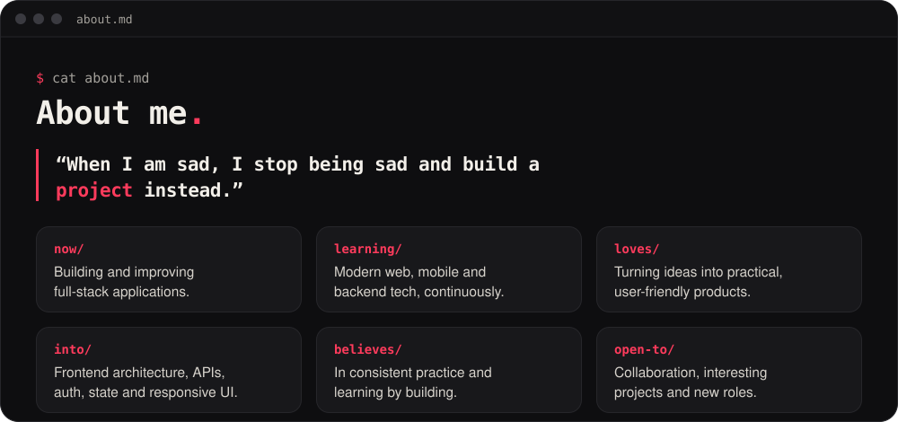

  

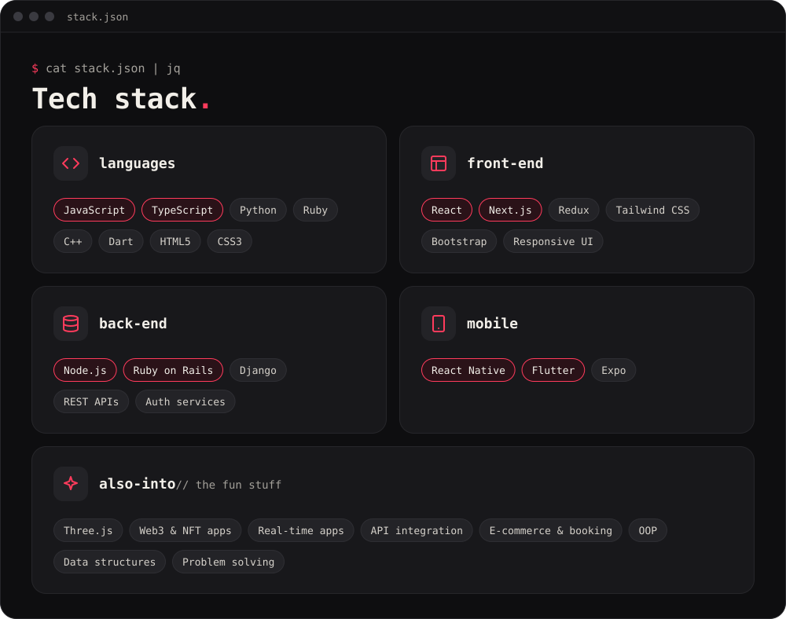

  

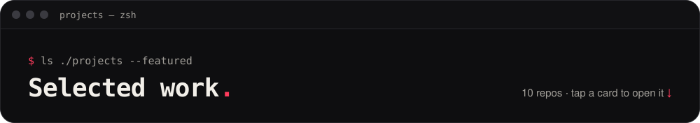

  <a href="https://github.com/Mohaiminul69/dev_stack_selector">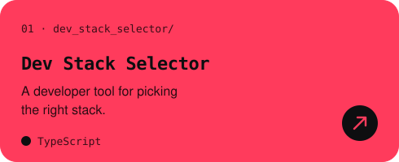</a>
  <a href="https://github.com/Mohaiminul69/dnd-kanban-board">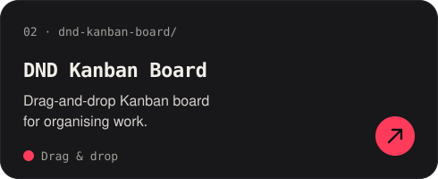</a>
  <a href="https://github.com/Mohaiminul69/ecommerce_project_react_19">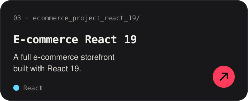</a>
  <a href="https://github.com/Mohaiminul69/university-management-auth-service-with-node.js">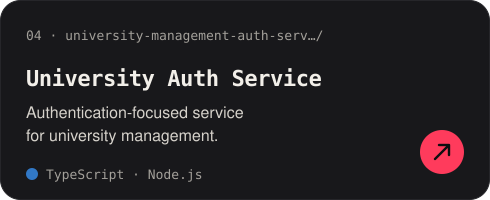</a>
  <a href="https://github.com/Mohaiminul69/tuzy-full-stack">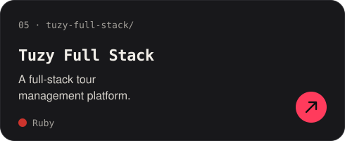</a>
  <a href="https://github.com/Mohaiminul69/next.js-portfolio-site">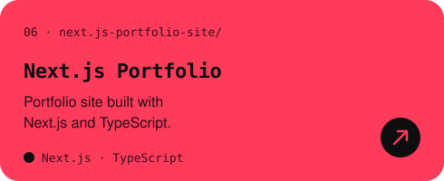</a>
  <a href="https://github.com/Mohaiminul69/ticket-booking-flutter-app">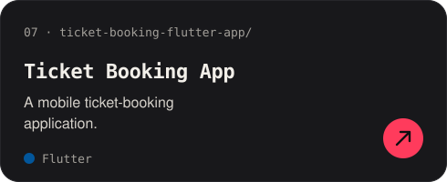</a>
  <a href="https://github.com/Mohaiminul69/react-native-note-app">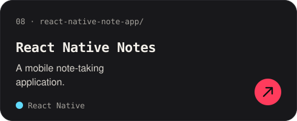</a>
  <a href="https://github.com/Mohaiminul69/thumbnail-generator">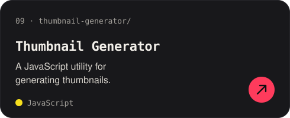</a>
  <a href="https://github.com/Mohaiminul69/problem-solving">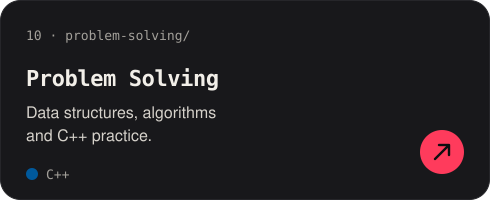</a>

 


  

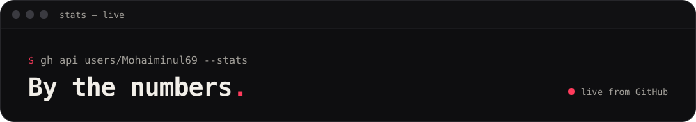

  
  

  

  

 

<a href="https://mohaiminul69.github.io/portfolio/">
  
</a>

  
  
  
  
  
  

